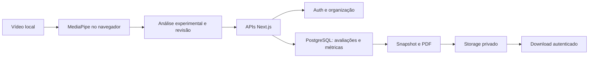

# MOVA · Engenharia de software e visão computacional

**Next.js · React · TypeScript · Tailwind CSS · Supabase · MediaPipe · Python**

O MOVA nasceu para investigar se vídeos comuns de caminhada poderiam apoiar a análise da marcha. O trabalho reuniu uma aplicação web, persistência multi-organização, relatórios PDF e experimentos de detecção temporal. Este repositório é uma edição independente para portfólio: apresenta o código e as conclusões publicáveis, preservando o projeto original em ambiente privado.

> O MOVA é um projeto experimental de software e visão computacional. O desenvolvimento do motor automático de análise da marcha está suspenso após resultados insuficientes de validação. O sistema não deve ser utilizado para diagnóstico ou decisões clínicas.

[Decisão técnica](docs/GAIT_FINAL_DECISION.md) · [Arquitetura e limites](docs/ARCHITECTURE.md) · [Qualidade e segurança](docs/PUBLICATION_REVIEW.md) · [Dependências e direitos](NOTICE.md)

## Engenharia implementada

| Área | O que o código oferece | Limite atual |
|---|---|---|
| Autenticação | Supabase SSR, cookies PKCE, login, recuperação e proteção de rotas | Requer ambiente próprio configurado; os testes desta edição são offline |
| Pacientes e avaliações | Cadastro, edição, arquivamento, histórico e APIs com escopo organizacional | Sem dados incluídos; persistência depende do schema |
| Persistência | RPC transacional para avaliação e métricas, idempotência e integridade referencial | SQL fornecido para revisão; nada é aplicado automaticamente |
| Vídeo | Seleção/captura, MediaPipe no navegador e revisão de resultados | Pose detectada não comprova contatos corretos |
| Relatórios | Geração PDF, snapshot versionado, armazenamento privado e download autenticado | Fluxo completo depende de Auth, banco e Storage próprios |
| Pesquisa | Módulos temporais experimentais, anotação por revisor e comparação um a um em Python | Sem vídeos, modelos de terceiros ou referências privadas |

Dashboard, planos e algumas telas de acompanhamento contêm estruturas de interface, não um SaaS comercial concluído. Cobranças estão desativadas. A disponibilidade de cada integração não é demonstrada apenas pela existência do código.

## Arquitetura



A aplicação distingue baixa qualidade de pose, ausência de medidas suficientes e resultados estimados. Velocidade exige distância medida correspondente ao intervalo. As limitações de detecção continuam presentes nesta edição; o motor não foi substituído para apresentação do portfólio.

## Estrutura

```text
src/app/             páginas e APIs
src/components/      interface, análise e relatórios
src/lib/             domínio, Supabase e módulos experimentais
supabase/migrations/ esquema incremental 001–008, sem dados
research/            comparação temporal Python e testes sintéticos
tests/              testes offline de software (sem contas reais)
docs/                documentação pública revisada
```

## Executar localmente

Pré-requisitos usados na verificação: Node.js e npm; Python 3 para os testes de comparação. Consulte as versões registradas no relatório de qualidade.

```powershell
npm ci --ignore-scripts
npm run dev
```

A página inicial pode ser explorada em `http://localhost:3000` sem Supabase. As rotas privadas exigem autenticação; esta edição não simula acesso nem fornece contas prontas.

Para usar integrações em um ambiente descartável próprio:

```powershell
Copy-Item .env.example .env.local
```

Configure `NEXT_PUBLIC_SUPABASE_URL`, `NEXT_PUBLIC_SUPABASE_ANON_KEY` (somente chave pública) e `NEXT_PUBLIC_APP_URL`. Não reutilize projetos de terceiros, dados reais ou credenciais privilegiadas. Revise as migrations em ordem num ambiente isolado compatível com Auth e Storage do Supabase. `npm run dev` e `npm run build` não aplicam SQL.

O analisador baixa WASM e modelo MediaPipe de fontes públicas quando utilizado. Os quadros são processados no navegador; persistência e upload são funcionalidades separadas. Esta publicação não inclui vídeos nem autoriza uso de imagens de terceiros.

## Testes

```powershell
npm run typecheck
npm run lint
npm test
npm run test:python
npm run build
```

Os testes Python exercitam funções existentes de associação temporal e adaptação com fixtures matemáticas. Não treinam modelos nem executam experimentos. Os testes TypeScript cobrem autenticação simulada, autorização, persistência, PDF, vídeo e regras temporais. Não comprovam funcionamento remoto ou precisão clínica.

## Pesquisa e resultados

Quatro métodos processaram 44 gravações laterais de 44 participantes do GaHu-Video V2:

| Método | Vídeos processados | Contatos candidatos |
|---|---:|---:|
| MOVA | 44/44 | 963 |
| MyoGait Heavy | 44/44 | 1.643 |
| MyoGait Lite | 44/44 | 2.131 |
| VideoGait | 44/44 | 587 |

São **176 processamentos, não 176 participantes e não contatos validados**. Não havia referência independente suficiente de contatos por pé nessa amostra. O MOVA se absteve de fornecer cadência nos 44 vídeos.

Um ensaio IntellEvent em dois vídeos de desenvolvimento, com dez contatos anotados, encontrou quatro correspondências, oito eventos extras e seis contatos perdidos a ±100 ms. Precisão exploratória de 33,3%, recall de 40% e F1 de 36,4%. Isso não constitui teste independente nem validação clínica. A [decisão final](docs/GAIT_FINAL_DECISION.md) explica o encerramento.

## Estado e segurança

O motor está suspenso. A edição serve para estudo de engenharia, não para atendimento de pacientes. Dependências com alertas conhecidos permanecem documentadas: **não exponha a aplicação à internet**. Não há deploy associado a esta publicação.

O histórico privado, runbooks de recuperação, backups, mídia acadêmica e evidências brutas não foram importados. O código de aplicação e as migrations foram preservados sem alteração funcional. A seleção pública de testes tem escopo menor que a suíte interna; veja o relatório de revisão.
